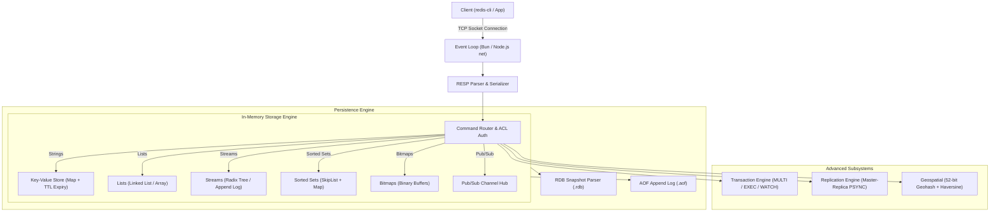

# 🚀 CodeCrafters Redis Challenge - Tài Liệu Toàn Tập 124 Thử Thách (Tiếng Việt)

Chào mừng bạn đến với tài liệu hướng dẫn hoàn chỉnh **124 thử thách tự xây dựng Redis Server từ đầu (Build Your Own Redis)** trên nền tảng [CodeCrafters](https://app.codecrafters.io/courses/redis/overview). 

Toàn bộ tài liệu được dịch thuật, phân tích chuyên sâu và biên soạn bằng **tiếng Việt**, kèm ví dụ thực tế bằng **TypeScript (Bun / Node.js)** tương thích 100% với cấu trúc repository hiện tại.

---

## 🧭 Kiến Trúc Tổng Quan Của Redis Server

Sơ đồ kiến trúc toàn diện của Redis Server bạn sẽ xây dựng qua 124 thử thách:



---

## 📊 Thống Kê & Phân Bổ 124 Thử Thách Theo 13 Module

| # | Phân Hệ Module | Thư Mục | Số Lượng | Phạm Vi Thử Thách | Tóm Tắt Chức Năng |
| :-: | :--- | :--- | :-: | :-: | :--- |
| **01** | ⚡ **Core (Nền tảng)** | [`01-core/`](./01-core/) | 7 | #001 - #007 | TCP socket, PING, ECHO, SET, GET, TTL |
| **02** | 📋 **Lists (Danh sách)** | [`02-lists/`](./02-lists/) | 11 | #008 - #018 | RPUSH, LPUSH, LRANGE, LLEN, LPOP, BLPOP |
| **03** | 🌊 **Streams (Luồng sự kiện)** | [`03-streams/`](./03-streams/) | 13 | #019 - #031 | TYPE, XADD (ID auto), XRANGE, XREAD, BLOCK |
| **04** | 🔄 **Transactions (Giao dịch)** | [`04-transactions/`](./04-transactions/) | 11 | #032 - #042 | INCR, MULTI, QUEUED, EXEC, DISCARD |
| **05** | 🔒 **Optimistic Locking** | [`05-optimistic-locking/`](./05-optimistic-locking/) | 8 | #043 - #050 | WATCH, Check-And-Set (CAS), UNWATCH |
| **06** | 🌐 **Replication (Nhân bản)** | [`06-replication/`](./06-replication/) | 18 | #051 - #068 | Master-Replica, Handshake, RDB, Offset, WAIT |
| **07** | 💾 **RDB Persistence** | [`07-persistence-rdb/`](./07-persistence-rdb/) | 6 | #069 - #074 | CONFIG GET, parse RDB nhị phân, KEYS * |
| **08** | 📝 **AOF Persistence** | [`08-persistence-aof/`](./08-persistence-aof/) | 10 | #075 - #084 | Append-only file, Manifest, Write log, Replay |
| **09** | 📢 **Pub/Sub (Phát/Nhận tin)** | [`09-pub-sub/`](./09-pub-sub/) | 7 | #085 - #091 | SUBSCRIBE, Subscribed mode, PUBLISH |
| **10** | 📊 **Sorted Sets (Tập sắp xếp)** | [`10-sorted-sets/`](./10-sorted-sets/) | 8 | #092 - #099 | ZADD, ZRANK, ZRANGE, ZCARD, ZSCORE, ZREM |
| **11** | 🔢 **Bitmaps (Thao tác Bit)** | [`11-bitmaps/`](./11-bitmaps/) | 9 | #100 - #108 | SETBIT, GETBIT, BITCOUNT, BITOP AND/OR |
| **12** | 🗺️ **Geospatial (Không gian địa lý)**| [`12-geospatial/`](./12-geospatial/) | 8 | #109 - #116 | GEOADD, Geohash 52-bit, GEOPOS, GEODIST |
| **13** | 🛡️ **Authentication & ACL** | [`13-authentication/`](./13-authentication/) | 8 | #117 - #124 | ACL WHOAMI, GETUSER, SETUSER, AUTH, -NOAUTH |
| **Tổng** | **13 Module Chuyên Sâu** | **docs/** | **124** | **#001 - #124** | **Toàn bộ giáo trình chính thức CodeCrafters Redis** |

---

## 📑 Danh Sách Chi Tiết Toàn Bộ 124 Thử Thách


### ⚡ Nền tảng & Lệnh cơ bản (Core) (7 Thử thách)

> Khởi tạo server TCP, vòng lặp sự kiện (event loop), phân tích cú pháp giao thức RESP, xử lý đồng thời nhiều client và các lệnh cơ bản PING, ECHO, SET, GET cùng cơ chế hết hạn TTL.

| # | Slug | Thử Thách (Tiếng Việt & English) | Độ Khó | Lệnh Chính | Trang Chi Tiết |
| :-: | :---: | :--- | :---: | :---: | :--- |
| **001** | `jm1` | Khởi tạo Server TCP và Lắng nghe trên Port 6379<br>*(Bind to a port)* | `Rất dễ` | `LISTEN 6379` | [📖 Xem bài viết](./01-core/001-bind-to-a-port.md) |
| **002** | `rg2` | Phản hồi lệnh PING đơn lẻ với +PONG\r\n<br>*(Respond to PING)* | `Dễ` | `PING` | [📖 Xem bài viết](./01-core/002-respond-to-ping.md) |
| **003** | `wy1` | Phản hồi nhiều lệnh PING liên tiếp trên cùng một kết nối<br>*(Respond to multiple PINGs)* | `Dễ` | `PING (multiple)` | [📖 Xem bài viết](./01-core/003-respond-to-multiple-pings.md) |
| **004** | `zu2` | Xử lý đồng thời nhiều client kết nối (Concurrency)<br>*(Handle concurrent clients)* | `Trung bình` | `CONCURRENCY` | [📖 Xem bài viết](./01-core/004-handle-concurrent-clients.md) |
| **005** | `qq0` | Cài đặt lệnh ECHO và giải mã Bulk String trong RESP<br>*(Implement the ECHO command)* | `Trung bình` | `ECHO <msg>` | [📖 Xem bài viết](./01-core/005-implement-the-echo-command.md) |
| **006** | `la7` | Cài đặt lệnh SET và GET lưu trữ Key-Value trong bộ nhớ RAM<br>*(Implement the SET & GET commands)* | `Trung bình` | `SET / GET` | [📖 Xem bài viết](./01-core/006-implement-the-set-and-get-commands.md) |
| **007** | `yz1` | Hỗ trợ thời gian sống TTL cho Key với tùy chọn PX (Milliseconds)<br>*(Expiry)* | `Trung bình` | `SET key val PX <ms>` | [📖 Xem bài viết](./01-core/007-expiry.md) |

### 📋 Cấu trúc dữ liệu Danh sách (Lists) (11 Thử thách)

> Cài đặt kiểu dữ liệu List trong Redis với các thao tác nối đầu (LPUSH), nối đuôi (RPUSH), cắt lát theo chỉ mục dương/âm (LRANGE), độ dài (LLEN), lấy ra (LPOP) và chặn lấy dữ liệu (BLPOP).

| # | Slug | Thử Thách (Tiếng Việt & English) | Độ Khó | Lệnh Chính | Trang Chi Tiết |
| :-: | :---: | :--- | :---: | :---: | :--- |
| **008** | `mh6` | Khởi tạo Danh sách mới bằng lệnh RPUSH<br>*(Create a list)* | `Dễ` | `RPUSH key element` | [📖 Xem bài viết](./02-lists/008-create-a-list.md) |
| **009** | `tn7` | Nối thêm một phần tử vào danh sách có sẵn bằng RPUSH<br>*(Append an element)* | `Dễ` | `RPUSH key element` | [📖 Xem bài viết](./02-lists/009-append-an-element.md) |
| **010** | `lx4` | Nối nhiều phần tử liên tiếp vào danh sách trong một lệnh RPUSH<br>*(Append multiple elements)* | `Dễ` | `RPUSH key el1 el2...` | [📖 Xem bài viết](./02-lists/010-append-multiple-elements.md) |
| **011** | `sf6` | Đọc danh sách phần tử bằng lệnh LRANGE với chỉ mục dương (0-based)<br>*(List elements (positive indexes))* | `Dễ` | `LRANGE key start stop` | [📖 Xem bài viết](./02-lists/011-list-elements-positive-indexes.md) |
| **012** | `ri1` | Đọc danh sách phần tử bằng LRANGE hỗ trợ chỉ mục âm (-1 là phần tử cuối)<br>*(List elements (negative indexes))* | `Dễ` | `LRANGE key -2 -1` | [📖 Xem bài viết](./02-lists/012-list-elements-negative-indexes.md) |
| **013** | `gu5` | Thêm phần tử vào đầu danh sách bằng lệnh LPUSH<br>*(Prepend elements)* | `Dễ` | `LPUSH key el1...` | [📖 Xem bài viết](./02-lists/013-prepend-elements.md) |
| **014** | `fv6` | Lấy độ dài hiện tại của danh sách bằng lệnh LLEN<br>*(Query list length)* | `Dễ` | `LLEN key` | [📖 Xem bài viết](./02-lists/014-query-list-length.md) |
| **015** | `ef1` | Lấy và xóa phần tử đầu danh sách bằng lệnh LPOP<br>*(Remove an element)* | `Dễ` | `LPOP key` | [📖 Xem bài viết](./02-lists/015-remove-an-element.md) |
| **016** | `jp1` | Lấy và xóa nhiều phần tử cùng lúc bằng LPOP kèm tham số count<br>*(Remove multiple elements)* | `Dễ` | `LPOP key [count]` | [📖 Xem bài viết](./02-lists/016-remove-multiple-elements.md) |
| **017** | `ec3` | Lấy phần tử có chặn với BLPOP (Chờ đến khi danh sách có dữ liệu)<br>*(Blocking retrieval)* | `Trung bình` | `BLPOP key timeout` | [📖 Xem bài viết](./02-lists/017-blocking-retrieval.md) |
| **018** | `xj7` | Hỗ trợ thời gian chờ timeout cho BLPOP (Trả về nil khi hết giờ)<br>*(Blocking retrieval with timeout)* | `Trung bình` | `BLPOP key timeout` | [📖 Xem bài viết](./02-lists/018-blocking-retrieval-with-timeout.md) |

### 🌊 Luồng sự kiện (Streams) (13 Thử thách)

> Hỗ trợ kiểu dữ liệu Stream (log bất biến có thứ tự thời gian), kiểm tra TYPE, chèn entry XADD với ID tự sinh/xác thực, truy vấn dải thời gian XRANGE, đọc đơn/đa luồng XREAD và chế độ chờ sự kiện chặn BLOCK.

| # | Slug | Thử Thách (Tiếng Việt & English) | Độ Khó | Lệnh Chính | Trang Chi Tiết |
| :-: | :---: | :--- | :---: | :---: | :--- |
| **019** | `cc3` | Cài đặt lệnh TYPE kiểm tra kiểu dữ liệu của key<br>*(The TYPE command)* | `Dễ` | `TYPE key` | [📖 Xem bài viết](./03-streams/019-the-type-command.md) |
| **020** | `cf6` | Khởi tạo Stream và chèn entry đầu tiên bằng lệnh XADD<br>*(Create a stream)* | `Trung bình` | `XADD key id k1 v1...` | [📖 Xem bài viết](./03-streams/020-create-a-stream.md) |
| **021** | `hq8` | Xác thực quy tắc thứ tự tăng dần của Entry ID (milliseconds-sequence)<br>*(Validating entry IDs)* | `Dễ` | `XADD ID validation` | [📖 Xem bài viết](./03-streams/021-validating-entry-ids.md) |
| **022** | `yh3` | Tự động sinh sequence number cho Entry ID dạng <ms>-*<br>*(Partially auto-generated IDs)* | `Trung bình` | `XADD key <ms>-* ...` | [📖 Xem bài viết](./03-streams/022-partially-auto-generated-ids.md) |
| **023** | `xu6` | Tự động sinh toàn bộ Entry ID khi client truyền ký tự '*'<br>*(Fully auto-generated IDs)* | `Trung bình` | `XADD key * ...` | [📖 Xem bài viết](./03-streams/023-fully-auto-generated-ids.md) |
| **024** | `zx1` | Truy vấn danh sách entry trong stream bằng lệnh XRANGE<br>*(Query entries from stream)* | `Trung bình` | `XRANGE key start end` | [📖 Xem bài viết](./03-streams/024-query-entries-from-stream.md) |
| **025** | `yp1` | Sử dụng mốc '-' đại diện cho ID nhỏ nhất trong XRANGE<br>*(Query with -)* | `Dễ` | `XRANGE key - end` | [📖 Xem bài viết](./03-streams/025-query-with-minus.md) |
| **026** | `fs1` | Sử dụng mốc '+' đại diện cho ID lớn nhất trong XRANGE<br>*(Query with +)* | `Dễ` | `XRANGE key start +` | [📖 Xem bài viết](./03-streams/026-query-with-plus.md) |
| **027** | `um0` | Đọc các entry mới từ một stream duy nhất bằng lệnh XREAD<br>*(Query single stream using XREAD)* | `Trung bình` | `XREAD STREAMS k id` | [📖 Xem bài viết](./03-streams/027-query-single-stream-using-xread.md) |
| **028** | `ru9` | Đọc đồng thời từ nhiều stream trong cùng một câu lệnh XREAD<br>*(Query multiple streams using XREAD)* | `Trung bình` | `XREAD STREAMS k1 k2 id1 id2` | [📖 Xem bài viết](./03-streams/028-query-multiple-streams-using-xread.md) |
| **029** | `bs1` | Chế độ đọc stream có chặn với tham số BLOCK <ms> trong XREAD<br>*(Blocking reads)* | `Khó` | `XREAD BLOCK <ms> STREAMS...` | [📖 Xem bài viết](./03-streams/029-blocking-reads.md) |
| **030** | `hw1` | Chờ vô thời hạn với XREAD BLOCK 0 cho đến khi có entry mới xuất hiện<br>*(Blocking reads without timeout)* | `Trung bình` | `XREAD BLOCK 0 STREAMS...` | [📖 Xem bài viết](./03-streams/030-blocking-reads-without-timeout.md) |
| **031** | `xu1` | Lắng nghe entry tương lai bằng cách chỉ định ID bắt đầu là '$'<br>*(Blocking reads using $)* | `Dễ` | `XREAD BLOCK <ms> STREAMS k $` | [📖 Xem bài viết](./03-streams/031-blocking-reads-using-dollar.md) |

### 🔄 Giao dịch & Tính nguyên tử (Transactions) (11 Thử thách)

> Cơ chế giao dịch ACID trong Redis: tăng số nguyên tự động INCR, mở khối MULTI, xếp hàng lệnh QUEUED, thực thi nguyên tử EXEC, hủy bỏ DISCARD và xử lý lỗi runtime trong giao dịch.

| # | Slug | Thử Thách (Tiếng Việt & English) | Độ Khó | Lệnh Chính | Trang Chi Tiết |
| :-: | :---: | :--- | :---: | :---: | :--- |
| **032** | `si4` | Cài đặt lệnh INCR tăng giá trị số nguyên trong key lên 1<br>*(The INCR command (1/3))* | `Dễ` | `INCR key` | [📖 Xem bài viết](./04-transactions/032-the-incr-command-1.md) |
| **033** | `lz8` | Tự động khởi tạo giá trị 0 rồi tăng lên 1 khi INCR key chưa tồn tại<br>*(The INCR command (2/3))* | `Dễ` | `INCR non-existing key` | [📖 Xem bài viết](./04-transactions/033-the-incr-command-2.md) |
| **034** | `mk1` | Báo lỗi ERR value is not an integer khi INCR chuỗi không phải số<br>*(The INCR command (3/3))* | `Dễ` | `INCR error validation` | [📖 Xem bài viết](./04-transactions/034-the-incr-command-3.md) |
| **035** | `pn0` | Bắt đầu một khối Transaction nguyên tử với lệnh MULTI<br>*(The MULTI command)* | `Dễ` | `MULTI` | [📖 Xem bài viết](./04-transactions/035-the-multi-command.md) |
| **036** | `lo4` | Kết thúc Transaction và thực thi toàn bộ lệnh bằng lệnh EXEC<br>*(The EXEC command)* | `Dễ` | `EXEC` | [📖 Xem bài viết](./04-transactions/036-the-exec-command.md) |
| **037** | `we1` | Xử lý khối transaction rỗng và phản hồi mảng rỗng *0\r\n<br>*(Empty transaction)* | `Khó` | `MULTI -> EXEC (empty)` | [📖 Xem bài viết](./04-transactions/037-empty-transaction.md) |
| **038** | `rs9` | Đưa các lệnh vào hàng đợi Transaction và phản hồi +QUEUED\r\n<br>*(Queueing commands)* | `Trung bình` | `QUEUED state` | [📖 Xem bài viết](./04-transactions/038-queueing-commands.md) |
| **039** | `fy6` | Thực thi tuần tự các lệnh trong hàng đợi và trả về mảng kết quả<br>*(Executing a transaction)* | `Khó` | `EXEC with queued commands` | [📖 Xem bài viết](./04-transactions/039-executing-a-transaction.md) |
| **040** | `rl9` | Hủy bỏ khối Transaction và xóa hàng đợi lệnh bằng DISCARD<br>*(The DISCARD command)* | `Dễ` | `DISCARD` | [📖 Xem bài viết](./04-transactions/040-the-discard-command.md) |
| **041** | `sg9` | Tiếp tục thực thi các lệnh còn lại khi có lệnh lỗi runtime trong EXEC<br>*(Failures within transactions)* | `Trung bình` | `EXEC error handling` | [📖 Xem bài viết](./04-transactions/041-failures-within-transactions.md) |
| **042** | `jf8` | Quản lý độc lập trạng thái transaction giữa nhiều client đồng thời<br>*(Multiple transactions)* | `Trung bình` | `Multi-client transactions` | [📖 Xem bài viết](./04-transactions/042-multiple-transactions.md) |

### 🔒 Khóa lạc quan (Optimistic Locking) (8 Thử thách)

> Cơ chế Check-And-Set (CAS) với lệnh WATCH theo dõi biến đổi của key, kiểm soát concurrency giữa nhiều client, hủy giao dịch khi có xung đột và các cơ chế UNWATCH tự động.

| # | Slug | Thử Thách (Tiếng Việt & English) | Độ Khó | Lệnh Chính | Trang Chi Tiết |
| :-: | :---: | :--- | :---: | :---: | :--- |
| **043** | `jb7` | Cài đặt lệnh WATCH theo dõi key để thực hiện khóa lạc quan (CAS)<br>*(The WATCH command)* | `Dễ` | `WATCH key` | [📖 Xem bài viết](./05-optimistic-locking/043-the-watch-command.md) |
| **044** | `jq9` | Từ chối thực thi lệnh WATCH nếu được gọi bên trong khối MULTI<br>*(WATCH inside transaction)* | `Dễ` | `WATCH inside MULTI error` | [📖 Xem bài viết](./05-optimistic-locking/044-watch-inside-transaction.md) |
| **045** | `mh8` | Hủy thực thi EXEC (trả về nil) nếu key bị thay đổi bởi client khác<br>*(Tracking key modifications)* | `Trung bình` | `Key modification CAS` | [📖 Xem bài viết](./05-optimistic-locking/045-tracking-key-modifications.md) |
| **046** | `fp0` | Theo dõi đồng thời danh sách nhiều key trong cùng một phiên làm việc<br>*(Watching multiple keys)* | `Trung bình` | `WATCH k1 k2...` | [📖 Xem bài viết](./05-optimistic-locking/046-watching-multiple-keys.md) |
| **047** | `uo9` | Theo dõi key chưa tồn tại (nếu key được tạo thì giao dịch bị hủy)<br>*(Watching missing keys)* | `Dễ` | `WATCH missing key` | [📖 Xem bài viết](./05-optimistic-locking/047-watching-missing-keys.md) |
| **048** | `bn1` | Hủy bỏ toàn bộ các key đang theo dõi với lệnh UNWATCH<br>*(The UNWATCH command)* | `Dễ` | `UNWATCH` | [📖 Xem bài viết](./05-optimistic-locking/048-the-unwatch-command.md) |
| **049** | `fn4` | Tự động xóa danh sách theo dõi của kết nối ngay khi lệnh EXEC hoàn tất<br>*(Unwatch on EXEC)* | `Dễ` | `Auto-unwatch on EXEC` | [📖 Xem bài viết](./05-optimistic-locking/049-unwatch-on-exec.md) |
| **050** | `hq1` | Tự động xóa danh sách theo dõi của kết nối khi gọi DISCARD<br>*(Unwatch on DISCARD)* | `Dễ` | `Auto-unwatch on DISCARD` | [📖 Xem bài viết](./05-optimistic-locking/050-unwatch-on-discard.md) |

### 🌐 Nhân bản Master - Replica (Replication) (18 Thử thách)

> Hệ thống phân tán Master-Replica: cờ cấu hình --port và --replicaof, lệnh INFO, bắt tay 3 bước (PING -> REPLCONF -> PSYNC), truyền snapshot RDB, truyền bá lệnh ghi thời gian thực, cơ chế ACK offset và đồng bộ lệnh WAIT.

| # | Slug | Thử Thách (Tiếng Việt & English) | Độ Khó | Lệnh Chính | Trang Chi Tiết |
| :-: | :---: | :--- | :---: | :---: | :--- |
| **051** | `bw1` | Hỗ trợ tham số dòng lệnh --port để chạy server trên cổng tùy chỉnh<br>*(Configure listening port)* | `Dễ` | `--port <port>` | [📖 Xem bài viết](./06-replication/051-configure-listening-port.md) |
| **052** | `ye5` | Phản hồi lệnh INFO replication với vai trò mặc định role:master<br>*(The INFO command)* | `Dễ` | `INFO replication (master)` | [📖 Xem bài viết](./06-replication/052-the-info-command.md) |
| **053** | `hc6` | Nhận diện vai trò role:slave khi khởi chạy kèm flag --replicaof<br>*(The INFO command on a replica)* | `Trung bình` | `--replicaof <host> <port>` | [📖 Xem bài viết](./06-replication/053-the-info-command-on-a-replica.md) |
| **054** | `xc1` | Sinh master_replid 40 ký tự ngẫu nhiên và master_repl_offset:0<br>*(Initial replication ID and offset)* | `Dễ` | `master_replid & offset` | [📖 Xem bài viết](./06-replication/054-initial-replication-id-and-offset.md) |
| **055** | `gl7` | Replica khởi tạo kết nối và gửi PING tới Master<br>*(Send handshake (1/3))* | `Dễ` | `Handshake step 1: PING` | [📖 Xem bài viết](./06-replication/055-send-handshake-1.md) |
| **056** | `eh4` | Replica gửi 2 lệnh REPLCONF listening-port và capa psync2<br>*(Send handshake (2/3))* | `Dễ` | `Handshake step 2: REPLCONF` | [📖 Xem bài viết](./06-replication/056-send-handshake-2.md) |
| **057** | `ju6` | Replica gửi lệnh PSYNC ? -1 yêu cầu Full Resynchronization<br>*(Send handshake (3/3))* | `Trung bình` | `Handshake step 3: PSYNC ? -1` | [📖 Xem bài viết](./06-replication/057-send-handshake-3.md) |
| **058** | `fj0` | Master tiếp nhận các lệnh REPLCONF từ Replica và phản hồi +OK\r\n<br>*(Receive handshake (1/2))* | `Dễ` | `Master handles REPLCONF` | [📖 Xem bài viết](./06-replication/058-receive-handshake-1.md) |
| **059** | `vm3` | Master phản hồi PSYNC bằng +FULLRESYNC <replid> 0<br>*(Receive handshake (2/2))* | `Dễ` | `Master sends +FULLRESYNC` | [📖 Xem bài viết](./06-replication/059-receive-handshake-2.md) |
| **060** | `cf8` | Master gửi snapshot RDB rỗng dưới dạng Bulk String tới Replica<br>*(Empty RDB transfer)* | `Dễ` | `Master sends empty RDB` | [📖 Xem bài viết](./06-replication/060-empty-rdb-transfer.md) |
| **061** | `zn8` | Master truyền bá (replicate) các lệnh ghi (write commands) tới 1 Replica<br>*(Single-replica propagation)* | `Trung bình` | `Single replica propagation` | [📖 Xem bài viết](./06-replication/061-single-replica-propagation.md) |
| **062** | `hd5` | Master truyền bá đồng thời các lệnh ghi tới nhiều Replica đang kết nối<br>*(Multi-replica propagation)* | `Khó` | `Multi-replica propagation` | [📖 Xem bài viết](./06-replication/062-multi-replica-propagation.md) |
| **063** | `yg4` | Replica xử lý và thực thi các lệnh nhận được từ Master vào bộ nhớ<br>*(Command processing)* | `Khó` | `Replica applies commands` | [📖 Xem bài viết](./06-replication/063-command-processing.md) |
| **064** | `xv6` | Replica phản hồi REPLCONF ACK 0 khi Master gửi REPLCONF GETACK *<br>*(ACKs with no commands)* | `Dễ` | `REPLCONF ACK 0` | [📖 Xem bài viết](./06-replication/064-acks-with-no-commands.md) |
| **065** | `yd3` | Replica theo dõi chính xác số byte offset đã nhận và phản hồi trong ACK<br>*(ACKs with commands)* | `Trung bình` | `REPLCONF ACK <offset>` | [📖 Xem bài viết](./06-replication/065-acks-with-commands.md) |
| **066** | `my8` | Cài đặt lệnh WAIT phản hồi ngay số replica khi không có replica nào kết nối<br>*(WAIT with no replicas)* | `Trung bình` | `WAIT numreplicas timeout` | [📖 Xem bài viết](./06-replication/066-wait-with-no-replicas.md) |
| **067** | `tu8` | Xử lý lệnh WAIT khi hệ thống chưa có lệnh ghi mới nào cần đồng bộ<br>*(WAIT with no commands)* | `Trung bình` | `WAIT with 0 pending writes` | [📖 Xem bài viết](./06-replication/067-wait-with-no-commands.md) |
| **068** | `na2` | Đồng bộ hóa master-replica: Master gửi GETACK và chờ đủ số lượng ACK<br>*(WAIT with multiple commands)* | `Khó` | `WAIT full synchronization` | [📖 Xem bài viết](./06-replication/068-wait-with-multiple-commands.md) |

### 💾 Lưu trữ bền vững RDB (RDB Persistence) (6 Thử thách)

> Phục hồi dữ liệu từ file nhị phân Redis Database (.rdb): cấu hình CONFIG GET dir/dbfilename, giải mã Magic bytes, Version, Database selector, Hash table sizes, Key-Value pairs, và lọc bỏ key hết hạn theo timestamp.

| # | Slug | Thử Thách (Tiếng Việt & English) | Độ Khó | Lệnh Chính | Trang Chi Tiết |
| :-: | :---: | :--- | :---: | :---: | :--- |
| **069** | `zg5` | Hỗ trợ lệnh CONFIG GET cho 2 tham số dir và dbfilename<br>*(RDB file config)* | `Dễ` | `CONFIG GET dir/dbfilename` | [📖 Xem bài viết](./07-persistence-rdb/069-rdb-file-config.md) |
| **070** | `jz6` | Đọc cấu trúc header RDB và trích xuất key đầu tiên từ database 0<br>*(Read a key)* | `Trung bình` | `Parse RDB key` | [📖 Xem bài viết](./07-persistence-rdb/070-read-a-key.md) |
| **071** | `gc6` | Giải mã String Value tương ứng của key từ định dạng nhị phân RDB<br>*(Read a string value)* | `Trung bình` | `Parse RDB string value` | [📖 Xem bài viết](./07-persistence-rdb/071-read-a-string-value.md) |
| **072** | `jw4` | Đọc toàn bộ các key trong file RDB và phục vụ lệnh KEYS *<br>*(Read multiple keys)* | `Trung bình` | `KEYS *` | [📖 Xem bài viết](./07-persistence-rdb/072-read-multiple-keys.md) |
| **073** | `dq3` | Phục hồi đầy đủ các cặp Key-Value từ file RDB vào bộ nhớ RAM<br>*(Read multiple string values)* | `Trung bình` | `Load full RDB into RAM` | [📖 Xem bài viết](./07-persistence-rdb/073-read-multiple-string-values.md) |
| **074** | `sm4` | Đọc timestamp hết hạn (opcode FD/FC) và bỏ qua các key đã hết hạn<br>*(Read value with expiry)* | `Trung bình` | `RDB expiry (FD & FC)` | [📖 Xem bài viết](./07-persistence-rdb/074-read-value-with-expiry.md) |

### 📝 Ghi nhật ký AOF (AOF Persistence) (10 Thử thách)

> Cơ chế bền vững Append Only File: cấu hình appendonly, tự động tạo thư mục và file manifest, ghi nhật ký các lệnh ghi dữ liệu theo thời gian thực (RESP format) và đọc replay lại lịch sử lệnh khi khởi động.

| # | Slug | Thử Thách (Tiếng Việt & English) | Độ Khó | Lệnh Chính | Trang Chi Tiết |
| :-: | :---: | :--- | :---: | :---: | :--- |
| **075** | `uj3` | Cung cấp giá trị mặc định cho cấu hình CONFIG GET appendonly (no)<br>*(Default AOF options)* | `Dễ` | `CONFIG GET appendonly` | [📖 Xem bài viết](./08-persistence-aof/075-default-aof-options.md) |
| **076** | `vd9` | Kích hoạt AOF khi người dùng truyền tham số dòng lệnh --appendonly yes<br>*(AOF options from flags)* | `Dễ` | `--appendonly yes` | [📖 Xem bài viết](./08-persistence-aof/076-aof-options-from-flags.md) |
| **077** | `fm0` | Tự động tạo thư mục appendonlydir nếu cấu hình AOF được bật<br>*(Create append-only directory)* | `Dễ` | `Directory appendonlydir` | [📖 Xem bài viết](./08-persistence-aof/077-create-append-only-directory.md) |
| **078** | `dw4` | Tự động tạo file dữ liệu appendonly.aof bên trong thư mục AOF<br>*(Create append-only file)* | `Dễ` | `File appendonly.aof` | [📖 Xem bài viết](./08-persistence-aof/078-create-append-only-file.md) |
| **079** | `pb9` | Tự động tạo file appendonly.aof.manifest quản lý Multi-Part AOF<br>*(Create manifest file)* | `Dễ` | `File appendonly.aof.manifest` | [📖 Xem bài viết](./08-persistence-aof/079-create-manifest-file.md) |
| **080** | `dc8` | Ghi 1 lệnh ghi dữ liệu (định dạng RESP) vào file AOF trên đĩa<br>*(Write a single command)* | `Khó` | `AOF append single write` | [📖 Xem bài viết](./08-persistence-aof/080-write-a-single-command.md) |
| **081** | `fi1` | Ghi nối tiếp nhiều lệnh ghi liên tiếp vào file AOF theo thời gian thực<br>*(Write multiple commands)* | `Trung bình` | `AOF append multiple writes` | [📖 Xem bài viết](./08-persistence-aof/081-write-multiple-commands.md) |
| **082** | `ep6` | Lọc chỉ ghi các lệnh biến đổi dữ liệu (SET,...) và bỏ qua lệnh đọc (GET, PING)<br>*(Filter write commands)* | `Dễ` | `AOF filter read-only commands` | [📖 Xem bài viết](./08-persistence-aof/082-filter-write-commands.md) |
| **083** | `xz2` | Phục hồi trạng thái server khi khởi động bằng cách đọc lại 1 lệnh từ file AOF<br>*(Replay a single command)* | `Khó` | `AOF replay single command` | [📖 Xem bài viết](./08-persistence-aof/083-replay-a-single-command.md) |
| **084** | `kn2` | Đọc và phát lại toàn bộ lịch sử lệnh trong file AOF để tái thiết lập bộ nhớ<br>*(Replay multiple commands)* | `Trung bình` | `AOF replay all commands` | [📖 Xem bài viết](./08-persistence-aof/084-replay-multiple-commands.md) |

### 📢 Xuất bản & Đăng ký tin (Pub/Sub) (7 Thử thách)

> Mô hình kiến trúc Event-Driven Pub/Sub: đăng ký kênh SUBSCRIBE, chuyển sang Subscribed Mode (hạn chế các lệnh thông thường), phát tin PUBLISH tới các subscriber đồng thời và hủy đăng ký UNSUBSCRIBE.

| # | Slug | Thử Thách (Tiếng Việt & English) | Độ Khó | Lệnh Chính | Trang Chi Tiết |
| :-: | :---: | :--- | :---: | :---: | :--- |
| **085** | `mx3` | Đăng ký nhận tin từ một kênh cụ thể bằng lệnh SUBSCRIBE<br>*(Subscribe to a channel)* | `Dễ` | `SUBSCRIBE channel` | [📖 Xem bài viết](./09-pub-sub/085-subscribe-to-a-channel.md) |
| **086** | `zc8` | Đăng ký đồng thời nhiều kênh trong một câu lệnh SUBSCRIBE duy nhất<br>*(Subscribe to multiple channels)* | `Dễ` | `SUBSCRIBE ch1 ch2...` | [📖 Xem bài viết](./09-pub-sub/086-subscribe-to-multiple-channels.md) |
| **087** | `aw8` | Chuyển kết nối sang Subscribed Mode (chỉ cho phép các lệnh Pub/Sub)<br>*(Enter subscribed mode)* | `Trung bình` | `Subscribed mode restriction` | [📖 Xem bài viết](./09-pub-sub/087-enter-subscribed-mode.md) |
| **088** | `lf1` | Xử lý lệnh PING đặc biệt khi client đang ở trong chế độ Subscribed Mode<br>*(PING in subscribed mode)* | `Dễ` | `PING in subscribed mode` | [📖 Xem bài viết](./09-pub-sub/088-ping-in-subscribed-mode.md) |
| **089** | `hf2` | Cài đặt lệnh PUBLISH gửi tin nhắn tới kênh và trả về số client nhận<br>*(Publish a message)* | `Dễ` | `PUBLISH channel message` | [📖 Xem bài viết](./09-pub-sub/089-publish-a-message.md) |
| **090** | `dn4` | Chuyển phát tin nhắn tức thì tới tất cả socket client đã đăng ký kênh đó<br>*(Deliver messages)* | `Khó` | `Broadcast to subscribers` | [📖 Xem bài viết](./09-pub-sub/090-deliver-messages.md) |
| **091** | `ze9` | Hủy đăng ký kênh bằng UNSUBSCRIBE và thoát chế độ Subscribed Mode<br>*(Unsubscribe)* | `Trung bình` | `UNSUBSCRIBE [channel]` | [📖 Xem bài viết](./09-pub-sub/091-unsubscribe.md) |

### 📊 Tập hợp có sắp xếp (Sorted Sets) (8 Thử thách)

> Cấu trúc dữ liệu ZSET: thêm phần tử kèm điểm số ZADD, tra cứu thứ hạng ZRANK, duyệt theo khoảng điểm ZRANGE với index âm, đếm số lượng ZCARD, đọc điểm ZSCORE và xóa phần tử ZREM.

| # | Slug | Thử Thách (Tiếng Việt & English) | Độ Khó | Lệnh Chính | Trang Chi Tiết |
| :-: | :---: | :--- | :---: | :---: | :--- |
| **092** | `ct1` | Khởi tạo Sorted Set mới bằng lệnh ZADD<br>*(Create a sorted set)* | `Dễ` | `ZADD key score member` | [📖 Xem bài viết](./10-sorted-sets/092-create-a-sorted-set.md) |
| **093** | `hf1` | Thêm nhiều cặp score-member và cập nhật điểm số nếu member đã tồn tại<br>*(Add members)* | `Trung bình` | `ZADD key s1 m1 s2 m2...` | [📖 Xem bài viết](./10-sorted-sets/093-add-members.md) |
| **094** | `lg6` | Lấy thứ hạng (rank 0-indexed) của member trong Sorted Set với ZRANK<br>*(Retrieve member rank)* | `Trung bình` | `ZRANK key member` | [📖 Xem bài viết](./10-sorted-sets/094-retrieve-member-rank.md) |
| **095** | `ic1` | Lấy danh sách member có điểm từ thấp đến cao bằng lệnh ZRANGE<br>*(List sorted set members)* | `Dễ` | `ZRANGE key start stop` | [📖 Xem bài viết](./10-sorted-sets/095-list-sorted-set-members.md) |
| **096** | `bj4` | Hỗ trợ chỉ mục âm trong ZRANGE (chẳng hạn 0 -1 để lấy toàn bộ tập hợp)<br>*(ZRANGE with negative indexes)* | `Dễ` | `ZRANGE key 0 -1` | [📖 Xem bài viết](./10-sorted-sets/096-zrange-with-negative-indexes.md) |
| **097** | `kn4` | Đếm tổng số lượng phần tử trong Sorted Set bằng lệnh ZCARD<br>*(Count sorted set members)* | `Dễ` | `ZCARD key` | [📖 Xem bài viết](./10-sorted-sets/097-count-sorted-set-members.md) |
| **098** | `gd7` | Lấy điểm số chính xác (float string) của member bằng lệnh ZSCORE<br>*(Retrieve member score)* | `Trung bình` | `ZSCORE key member` | [📖 Xem bài viết](./10-sorted-sets/098-retrieve-member-score.md) |
| **099** | `sq7` | Xóa một hoặc nhiều member khỏi Sorted Set bằng lệnh ZREM<br>*(Remove a member)* | `Dễ` | `ZREM key member` | [📖 Xem bài viết](./10-sorted-sets/099-remove-a-member.md) |

### 🔢 Thao tác dữ liệu Bit (Bitmaps) (9 Thử thách)

> Xử lý bitmask nhị phân trên chuỗi String: gán bit SETBIT, đọc bit GETBIT, chuyển đổi qua lại giữa chuỗi và bit, tự động đệm byte 0 khi mở rộng bitmap, đếm bit 1 bằng BITCOUNT và các phép toán logic BITOP AND/OR trên nhiều chuỗi bit.

| # | Slug | Thử Thách (Tiếng Việt & English) | Độ Khó | Lệnh Chính | Trang Chi Tiết |
| :-: | :---: | :--- | :---: | :---: | :--- |
| **100** | `bq9` | Khởi tạo Bitmap và gán giá trị bit tại offset cụ thể bằng SETBIT<br>*(Create a bitmap)* | `Trung bình` | `SETBIT key offset val` | [📖 Xem bài viết](./11-bitmaps/100-create-a-bitmap.md) |
| **101** | `qj1` | Đọc giá trị của bit tại vị trí offset bất kỳ bằng lệnh GETBIT<br>*(Retrieve a bit)* | `Dễ` | `GETBIT key offset` | [📖 Xem bài viết](./11-bitmaps/101-retrieve-a-bit.md) |
| **102** | `yj2` | Đọc các bit của một chuỗi String thông thường bằng lệnh GETBIT<br>*(Read a string as bits)* | `Trung bình` | `GETBIT on string value` | [📖 Xem bài viết](./11-bitmaps/102-read-a-string-as-bits.md) |
| **103** | `pk5` | Đọc toàn bộ chuỗi byte nhị phân của Bitmap bằng lệnh GET<br>*(Read bits as a string)* | `Dễ` | `GET on bitmap key` | [📖 Xem bài viết](./11-bitmaps/103-read-bits-as-a-string.md) |
| **104** | `yf6` | Tự động mở rộng kích thước chuỗi byte kèm đệm byte 0 khi offset vượt quá độ dài<br>*(Grow a bitmap)* | `Dễ` | `Bitmap auto padding` | [📖 Xem bài viết](./11-bitmaps/104-grow-a-bitmap.md) |
| **105** | `nx3` | Đếm tổng số lượng bit 1 trong Bitmap bằng lệnh BITCOUNT<br>*(Count set bits)* | `Trung bình` | `BITCOUNT key [start end]` | [📖 Xem bài viết](./11-bitmaps/105-count-set-bits.md) |
| **106** | `hv4` | Thực hiện phép toán logic AND giữa hai Bitmap bằng lệnh BITOP AND<br>*(AND two bitmaps)* | `Trung bình` | `BITOP AND dest k1 k2` | [📖 Xem bài viết](./11-bitmaps/106-and-two-bitmaps.md) |
| **107** | `dk2` | Xử lý phép toán BITOP AND khi các Bitmap nguồn có độ dài byte khác nhau<br>*(AND bitmaps of different lengths)* | `Trung bình` | `BITOP AND different lengths` | [📖 Xem bài viết](./11-bitmaps/107-and-bitmaps-of-different-lengths.md) |
| **108** | `fr8` | Thực hiện phép toán logic OR giữa các Bitmap bằng lệnh BITOP OR<br>*(OR two bitmaps)* | `Dễ` | `BITOP OR dest k1 k2...` | [📖 Xem bài viết](./11-bitmaps/108-or-two-bitmaps.md) |

### 🗺️ Dữ liệu Không gian địa lý (Geospatial) (8 Thử thách)

> Xử lý tọa độ GPS (Kinh độ/Vĩ độ) dựa trên Sorted Sets: kiểm tra tính hợp lệ của tọa độ, mã hóa thành số nguyên 52-bit Geohash score, lưu trữ bằng GEOADD, giải mã bằng GEOPOS, tính khoảng cách mặt cầu GEODIST (Haversine) và tìm kiếm quanh bán kính GEOSEARCH.

| # | Slug | Thử Thách (Tiếng Việt & English) | Độ Khó | Lệnh Chính | Trang Chi Tiết |
| :-: | :---: | :--- | :---: | :---: | :--- |
| **109** | `zt4` | Tiếp nhận và phản hồi lệnh thêm tọa độ địa lý GEOADD<br>*(Respond to GEOADD)* | `Dễ` | `GEOADD key lon lat member` | [📖 Xem bài viết](./12-geospatial/109-respond-to-geoadd.md) |
| **110** | `ck3` | Kiểm tra giới hạn hợp lệ của kinh độ [-180, 180] và vĩ độ [-85.05112878, 85.05112878]<br>*(Validate coordinates)* | `Dễ` | `GEOADD bounds validation` | [📖 Xem bài viết](./12-geospatial/110-validate-coordinates.md) |
| **111** | `tn5` | Lưu trữ vị trí địa lý vào Sorted Set nền tảng bên dưới<br>*(Store a location)* | `Trung bình` | `GEOADD storage in zset` | [📖 Xem bài viết](./12-geospatial/111-store-a-location.md) |
| **112** | `cr3` | Mã hóa cặp tọa độ (kinh độ, vĩ độ) thành số nguyên 52-bit Geohash<br>*(Calculate location score)* | `Khó` | `52-bit Geohash encoding` | [📖 Xem bài viết](./12-geospatial/112-calculate-location-score.md) |
| **113** | `xg4` | Lấy tọa độ kinh/vĩ độ của một hoặc nhiều địa điểm bằng GEOPOS<br>*(Respond to GEOPOS)* | `Dễ` | `GEOPOS key member...` | [📖 Xem bài viết](./12-geospatial/113-respond-to-geopos.md) |
| **114** | `hb5` | Giải mã số nguyên 52-bit Geohash ngược lại thành kinh độ và vĩ độ ban đầu<br>*(Decode coordinates)* | `Khó` | `52-bit Geohash decoding` | [📖 Xem bài viết](./12-geospatial/114-decode-coordinates.md) |
| **115** | `ek6` | Tính khoảng cách địa lý giữa hai địa điểm bằng lệnh GEODIST (Haversine)<br>*(Calculate distance)* | `Trung bình` | `GEODIST key m1 m2 [unit]` | [📖 Xem bài viết](./12-geospatial/115-calculate-distance.md) |
| **116** | `rm9` | Tìm kiếm các địa điểm nằm trong bán kính quy định bằng lệnh GEOSEARCH<br>*(Search within radius)* | `Dễ` | `GEOSEARCH key FROMLONLAT...` | [📖 Xem bài viết](./12-geospatial/116-search-within-radius.md) |

### 🛡️ Xác thực & Phân quyền ACL (Authentication) (8 Thử thách)

> Cơ chế bảo mật Access Control List (ACL) và xác thực người dùng: truy vấn user hiện tại với ACL WHOAMI, xem chi tiết ACL GETUSER default, cờ nopass/passwords, đặt mật khẩu với ACL SETUSER, xác thực qua AUTH và bắt buộc chặn lệnh với lỗi -NOAUTH.

| # | Slug | Thử Thách (Tiếng Việt & English) | Độ Khó | Lệnh Chính | Trang Chi Tiết |
| :-: | :---: | :--- | :---: | :---: | :--- |
| **117** | `jn4` | Phản hồi lệnh ACL WHOAMI trả về username hiện tại (mặc định 'default')<br>*(Respond to ACL WHOAMI)* | `Dễ` | `ACL WHOAMI` | [📖 Xem bài viết](./13-authentication/117-respond-to-acl-whoami.md) |
| **118** | `gx8` | Lấy toàn bộ thuộc tính của tài khoản default qua lệnh ACL GETUSER default<br>*(Respond to ACL GETUSER)* | `Dễ` | `ACL GETUSER default` | [📖 Xem bài viết](./13-authentication/118-respond-to-acl-getuser.md) |
| **119** | `ql6` | Trả về cờ 'nopass' trong danh sách flags khi tài khoản chưa đặt mật khẩu<br>*(The nopass flag)* | `Dễ` | `ACL flags with nopass` | [📖 Xem bài viết](./13-authentication/119-the-nopass-flag.md) |
| **120** | `pl7` | Trả về mảng rỗng [] cho thuộc tính passwords của user khi chưa có mật khẩu<br>*(The passwords property)* | `Dễ` | `ACL passwords property` | [📖 Xem bài viết](./13-authentication/120-the-passwords-property.md) |
| **121** | `uv9` | Cài đặt mật khẩu cho tài khoản default bằng lệnh ACL SETUSER default >password<br>*(Setting default user password)* | `Trung bình` | `ACL SETUSER default >pass` | [📖 Xem bài viết](./13-authentication/121-setting-default-user-password.md) |
| **122** | `hz3` | Cài đặt lệnh AUTH kiểm tra mật khẩu hợp lệ và phản hồi +OK\r\n<br>*(The AUTH command)* | `Trung bình` | `AUTH [user] password` | [📖 Xem bài viết](./13-authentication/122-the-auth-command.md) |
| **123** | `nm2` | Chặn các lệnh khác và trả về lỗi -NOAUTH khi kết nối chưa được xác thực<br>*(Enforce authentication)* | `Trung bình` | `Authentication enforcement` | [📖 Xem bài viết](./13-authentication/123-enforce-authentication.md) |
| **124** | `ws7` | Xác thực thành công bằng AUTH và mở khóa toàn bộ quyền thực thi lệnh<br>*(Authenticate using AUTH)* | `Trung bình` | `Full auth unlock` | [📖 Xem bài viết](./13-authentication/124-authenticate-using-auth.md) |

---

## 🛠️ Hướng Dẫn Phát Triển & Kiểm Thử

### 1. Khởi chạy Server cục bộ
```bash
# Kiểm tra phiên bản Bun
bun --version

# Khởi chạy Redis server bằng script
./your_program.sh
```

### 2. Tương tác thử nghiệm với `redis-cli`
Trong một terminal khác, bạn có thể gửi lệnh để kiểm tra ngay lập tức:
```bash
redis-cli PING
redis-cli SET mykey "Hello CodeCrafters"
redis-cli GET mykey
```

### 3. Nộp bài lên CodeCrafters để chấm tự động
Sau khi hoàn thành mã nguồn cho từng thử thách, chạy lệnh:
```bash
codecrafters submit
```
Hệ thống sẽ chạy bộ test case trên cloud và stream kết quả về terminal của bạn.

---

> 💡 *Tài liệu được biên soạn đồng bộ với phiên bản mới nhất của CodeCrafters Redis Challenge (tháng 10/2026).*
